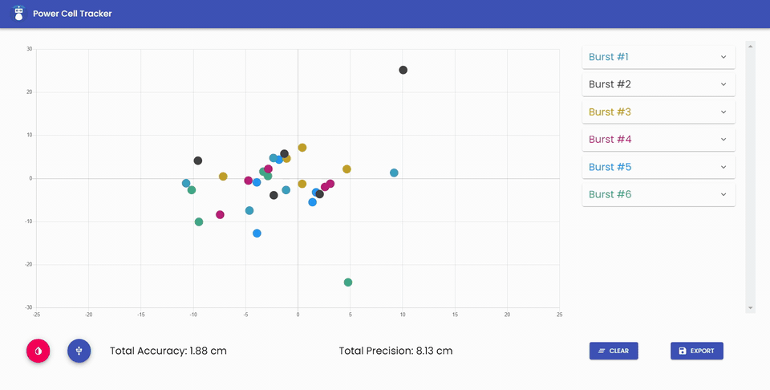
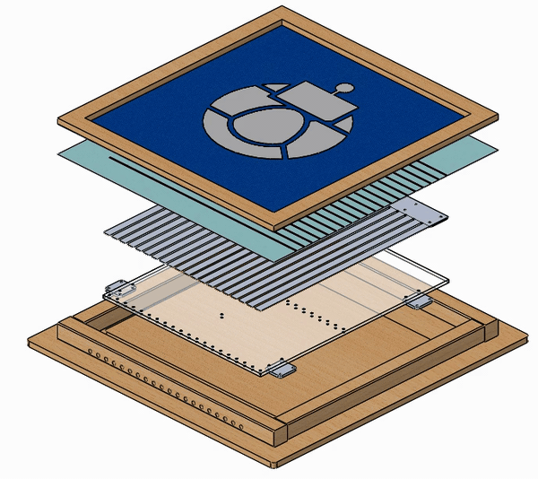
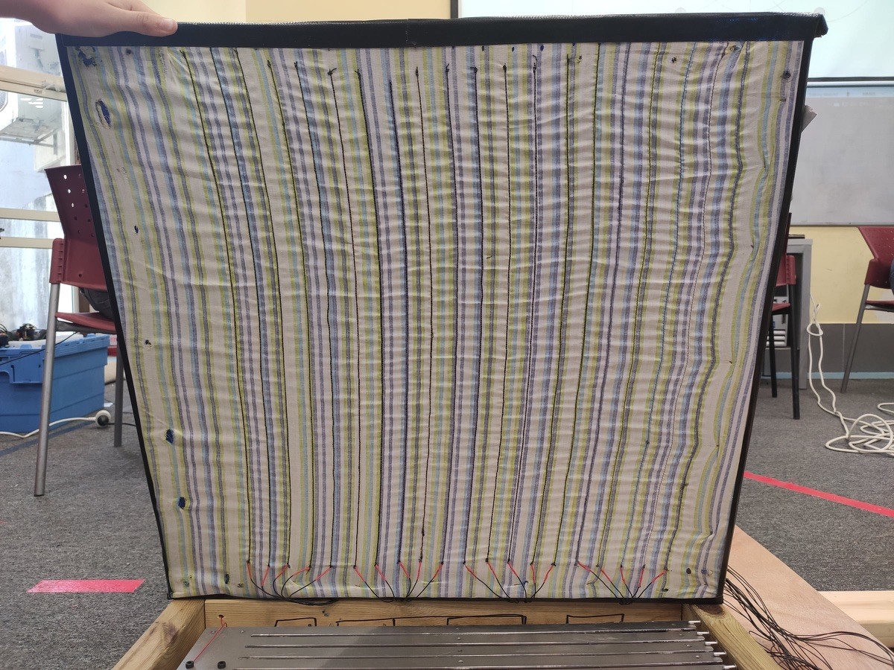
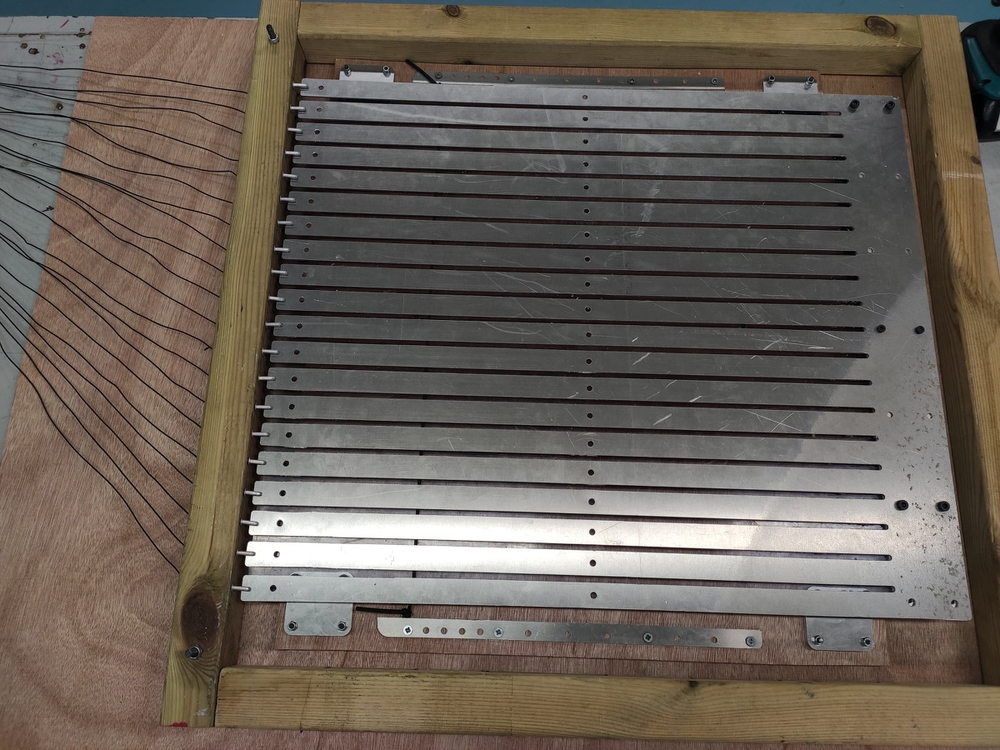
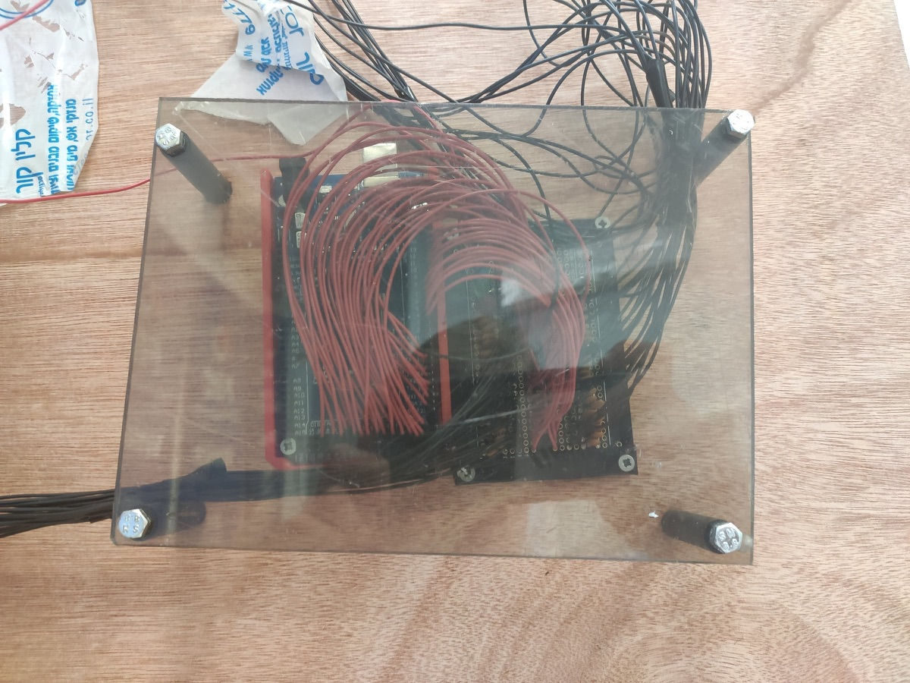
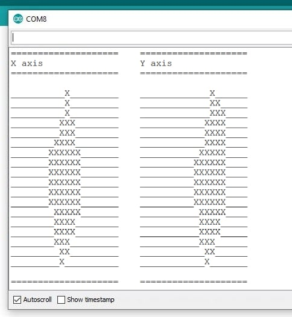

<div align="center">

# Power Cell Tracker

**An impact-sensing target and desktop app that measure how accurately an FRC robot shoots.**

Built for FRC team ORBIT 1690 · [Watch it in action](https://youtu.be/IpdLMfcgM5w?t=14) · [Full write-up](https://guynoimark.com/work/smart-target/) · [Chief Delphi thread](https://www.chiefdelphi.com/t/orbit-1690-off-season-project-power-cell-tracker/393144)



</div>

## Why

When you build a shooting mechanism, it's hard to make it precise, and even harder to know how precise it really is. We wanted to measure our robot's accuracy scientifically and see how consistently it hits the same spot, so I led a team of three to build a target that reports exactly where every ball lands.

This system helped us develop a reliable, accurate shooter for the following season, which contributed to a 90% competition win rate.

## How it works

The system has three parts:

1. **The target board:** a frame with two layers that react to a hit
2. **An Arduino Mega:** detects which circuits a ball changed and calculates the X and Y of the hit
3. **This desktop app:** reads the hits over USB, then plots and analyzes them

<p align="center">
  
</p>

Steel wires sewn into the fabric run up and down, and aluminum strips under them run side to side. When a ball lands, it presses a few wires onto the strips, which closes their circuits and gives the X position. The same hit pushes a few strips away from their pins, which opens their circuits and gives the Y position. The Arduino takes the center of all the triggered wires and strips as the hit point.

| Top layer: steel wires sewn into the fabric | Bottom layer: aluminum strips |
| --- | --- |
|  |  |

| The Arduino Mega wired to the target | What the Arduino sees on a hit |
| --- | --- |
|  |  |

## What the app does

- **Live scatter plot** of every hit, centered on the target. New shots show up as large grey dots.
- **Groups shots into bursts.** When no new ball arrives for 2 seconds, the shots so far become one colored burst.
- **Accuracy:** average distance of the hits from the center, in cm.
- **Precision:** how tightly the hits group together (standard deviation around their average point), in cm.
- **Inner port check:** each ball is marked green if it landed within 17 cm of the center.
- Session totals, an expandable card for every burst, and buttons to clear the session or export the data.

The app finds the Arduino by looking for a serial port whose manufacturer is "Arduino", at 115200 baud. Each line it receives is one hit: `x,y,errorCode`, with x and y in cm from the center.

## Tech

Electron, React, TypeScript, Material UI, Chart.js (`react-chartjs-2`) and `serialport`, built with Electron Forge and webpack.

## Run it

```bash
npm install
npm start
```

Plug in the Arduino before starting. The app opens full screen. To build an installer for your OS, run `npm run make`.

## Team

Built by ORBIT 1690 students, with [Noam Prag](https://github.com/NoamPrag). I led the project and built the Arduino logic and the app.
